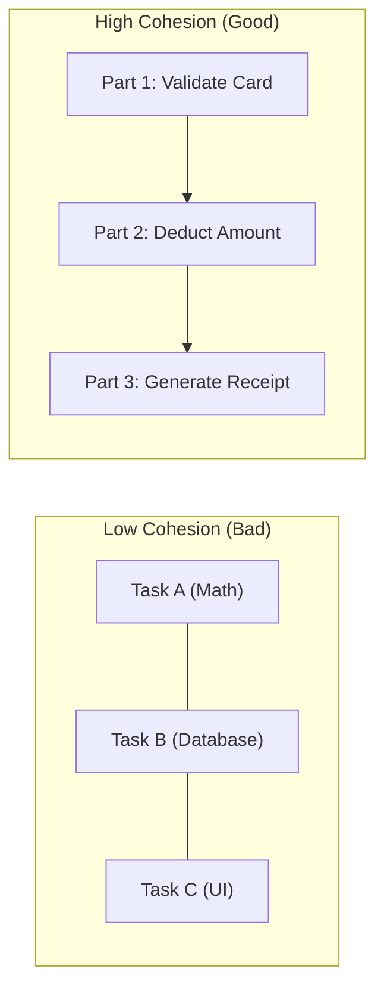
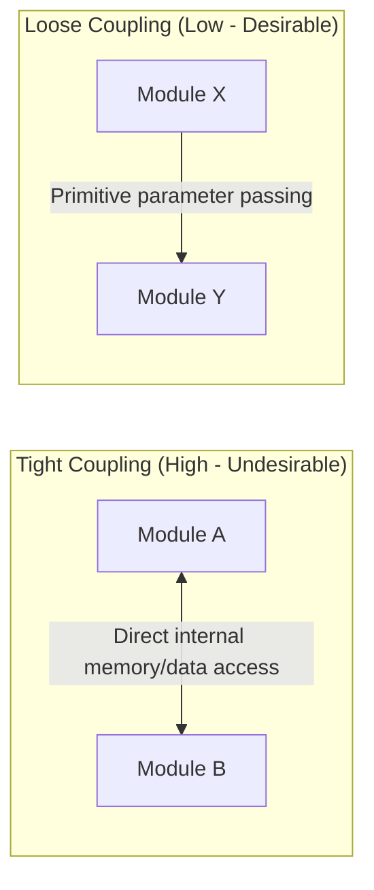
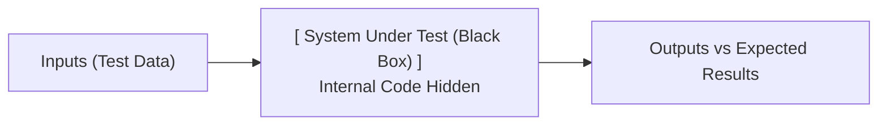
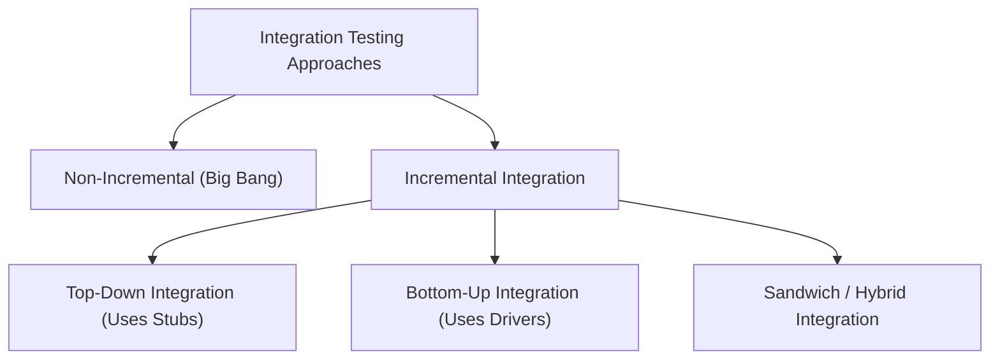
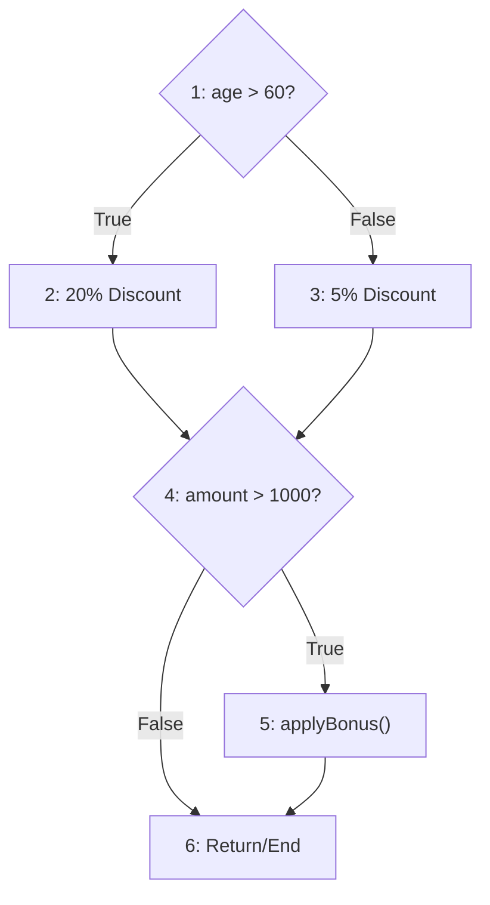
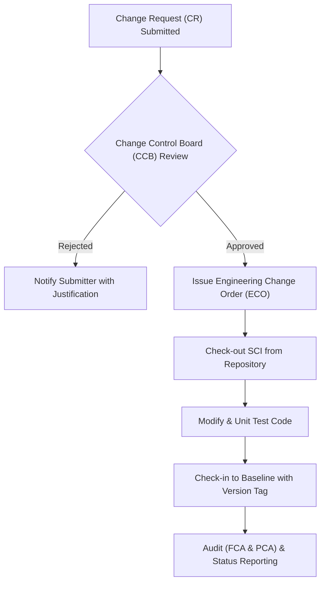
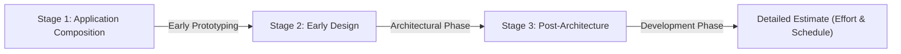

# Software Engineering PT-II: Model Question Bank Solutions
**Academic Term:** July – November 2026  
**Subject:** Software Engineering (PT-II Examination)  
**Weightage:** 5 Marks per Question  

---

## Quick Navigation Index

1. [Question 1: Cohesion & Its Types](#question-1-what-is-cohesion-list-and-explain-its-types)
2. [Question 2: Coupling & Its Types](#question-2-what-is-coupling-list-and-explain-its-types)
3. [Question 3: Design Engineering & Concepts](#question-3-define-design-engineering-and-its-concepts)
4. [Question 4: Software Architecture & Architectural Styles](#question-4-define-software-architecture-styles-and-diagrams)
5. [Question 5: Black Box Testing in Detail](#question-5-what-is-black-box-testing-explain-in-detail)
6. [Question 6: Integration Testing & Its Types](#question-6-explain-integration-testing-and-its-types)
7. [Question 7: White Box Testing in Detail](#question-7-explain-in-detail-white-box-testing)
8. [Question 8: RMMM Plan for Staff Turnover / Attrition](#question-8-design-an-rmmm-plan-for-a-problem-statement)
9. [Question 9: Software Configuration Management (SCM)](#question-9-explain-software-configuration-management-scm)
10. [Question 10: Function Point Analysis & Solved Numerical](#question-10-explain-function-point-analysis-and-solve-a-problem)
11. [Question 11: Size-Oriented vs. Function-Oriented Metrics](#question-11-size-oriented-vs-function-oriented-metrics)
12. [Question 12: COCOMO II Estimation Model](#question-12-explain-cocomo-ii-estimation-model)

---

## Question 1: What is Cohesion? List and Explain Its Types

### 1. Definition (1 Mark)
**Cohesion** is a qualitative measure of the degree to which elements inside a single software module belong together and focus on a single, well-defined purpose. It measures **intra-module strength**.
- **Design Principle:** Good software design aims for **High/Strong Cohesion**, which leads to better maintainability, readability, reusability, and lower defect density.



### 2. Types of Cohesion (Ordered from Lowest/Worst to Highest/Best) (4 Marks)

```
Coincidental < Logical < Temporal < Procedural < Communicational < Sequential < Functional
[ Worst / Weakest ] -----------------------------------------------> [ Best / Strongest ]
```

| Type | Description | Real-World Example |
| :--- | :--- | :--- |
| **1. Coincidental Cohesion** *(Worst)* | Elements are placed together completely arbitrarily with no meaningful relationship. | A generic `Utility` class that bundles `calculateSine()`, `printInvoice()`, and `checkDiskSpace()`. |
| **2. Logical Cohesion** | Elements perform logically similar tasks, but the exact operation executed is selected by an external control flag. | A function `handleInput(int eventType)` that executes completely different routines for mouse clicks, key presses, and touch taps via a `switch` statement. |
| **3. Temporal Cohesion** | Elements are executed around the same time during program execution, without sharing data. | A function `initializeSystem()` that sets up logging, opens a database connection, and loads the GUI splash screen at startup. |
| **4. Procedural Cohesion** | Elements execute in a specific sequence or algorithm, but operate on different data. | A routine `readConfigThenCheckPermissions()` where reading the file must precede permission checks, but they do not pass data between each other. |
| **5. Communicational Cohesion** | All elements operate on or produce the exact same input/output data structure. | A function `processStudentRecord()` that takes a `Student` record, calculates the GPA, and generates the grade card report from that same record. |
| **6. Sequential Cohesion** | The output of one element serves as the direct input to the next element (pipeline processing). | An audio routine `formatAndCompressAudio()`: Step 1 removes background noise, its raw audio output is fed to Step 2 for compression, and its output is written to disk. |
| **7. Functional Cohesion** *(Best)* | Every single instruction inside the module contributes to executing **exactly one single, well-defined mathematical or logical task**. | `computeSquareRoot(double number)` or `calculateMonthlyPayroll(Employee emp)`. |

---

## Question 2: What is Coupling? List and Explain Its Types

### 1. Definition (1 Mark)
**Coupling** is a measure of the degree of interdependence and interconnection between two or more software modules. It represents **inter-module connectivity**.
- **Design Principle:** Good software engineering strives for **Low/Loose Coupling**. Loose coupling ensures that modifications in one module do not ripple unpredictably into other modules.



### 2. Types of Coupling (Ordered from Highest/Worst to Lowest/Best) (4 Marks)

```
Content > Common > Control > Stamp > Data > Message / No Coupling
[ Worst / Tightest ] -----------------------------------------> [ Best / Loosest ]
```

| Type | Description | Real-World Example |
| :--- | :--- | :--- |
| **1. Content Coupling (Pathological)** *(Worst)* | One module directly accesses, references, or modifies the private memory, code, or internal state of another module. | Module A modifies the private variables of Module B directly via pointer offsets or executes a `goto` into the middle of Module B's code. |
| **2. Common Coupling** | Multiple modules share read and write access to the same global data space or shared memory buffer. | Module `Billing` and Module `Inventory` both read and write to a shared global variable `public static int g_systemStatus`. |
| **3. Control Coupling** | One module passes control information (flags, switches) to another module to deliberately dictate its internal execution logic. | Calling `calculatePay(employee, boolean isExecutive)` where the boolean flag controls whether bonus algorithms run. |
| **4. Stamp Coupling (Data-Structured)** | Modules pass a composite data structure (e.g., class, struct), but the receiving module only uses a small fraction of the fields. | Passing an entire `Employee` object containing 60 fields to a function `printBadge()` that only requires the `name` and `photoURL`. |
| **5. Data Coupling** *(Best Practical)* | Modules interact purely by passing discrete, primitive data parameters (e.g., `int`, `float`, `string`) where every parameter is strictly needed. | Calling `calculateHypotenuse(double a, double b)`. |
| **6. Message Coupling** *(Ideal)* | Modules have no shared state and communicate strictly via message-passing interfaces or event streams. | Microservices communicating asynchronously through JSON messages over an AMQP message queue. |

---

## Question 3: Define Design Engineering and Its Concepts

### 1. Definition of Design Engineering (1 Mark)
**Design Engineering** is the disciplined decision-making process in which customer requirements (from the SRS) are iteratively transformed into a complete, verifiable blueprint for constructing the software. It encompasses four key design levels:
1. **Data/Class Design** (data structures and relationships)
2. **Architectural Design** (overall structural framework)
3. **Interface Design** (UI and inter-component communication)
4. **Component-Level Design** (algorithmic and procedural logic)

### 2. List of Fundamental Design Concepts (1.5 Marks)
According to Roger S. Pressman, the core design concepts are:
1. **Abstraction**
2. **Architecture**
3. **Patterns**
4. **Modularity**
5. **Information Hiding**
6. **Functional Independence (Cohesion & Coupling)**
7. **Refinement (Stepwise Elaboration)**
8. **Refactoring**
9. **Design Classes**

### 3. Detailed Explanation of Any Three Concepts (2.5 Marks)

#### A. Abstraction
Abstraction allows engineers to focus on essential attributes while ignoring irrelevant internal implementation details.
- **Procedural Abstraction:** A named sequence of instructions with a specific function (e.g., `openDoor()` implies turning the handle and pulling without exposing torque, motor voltage, or latch friction).
- **Data Abstraction:** A named collection of data describing a data object (e.g., a `Queue` data type exposes `enqueue()` and `dequeue()` while hiding the underlying circular linked list).

#### B. Modularity
Modularity divides software into distinct, independently addressable, and integrable components (modules).
- By following the divide-and-conquer strategy, modularity reduces the cognitive complexity of large systems.
- According to Mayer's criteria, a modular design must satisfy: *Modular Decomposability, Modular Composability, Modular Understandability, Modular Continuity, and Modular Protection*.

```
Total Cost = Cost of Components (decreases with modularity) + Cost of Integration (increases with modularity)
Optimal modularity is reached at the minimum of the total cost curve.
```

#### C. Information Hiding (Parnas' Principle)
Information hiding mandates that modules should be characterized by design decisions that are concealed from all other modules.
- Modules communicate exclusively through well-defined public interfaces.
- **Example:** In an Object-Oriented system, declaring fields as `private` and exposing access via `getters/setters` conceals the storage implementation (e.g., switching an internal array to a hash map does not break client modules).

---

## Question 4: Define Software Architecture, Styles, and Diagrams

### 1. Definition (1 Mark)
**Software Architecture** is the fundamental organization of a software system, embodied in its components, their relationships to each other and to the environment, and the principles guiding its design and evolution (IEEE 1471 / Shaw & Garlan).

### 2. Four Architectural Styles with Diagrams & Examples (4 Marks)

#### Style 1: Data-Centered Architecture (Repository / Blackboard)
- **Concept:** A central data store (database or blackboard) is accessed frequently by independent client components that create, retrieve, update, or delete data.
- **Example:** Integrated Development Environments (IDEs like VS Code, Eclipse) where the syntax tree is the shared repository accessed by compiler, linter, debugger, and editor.

```
       +---------------+
       | Client Tool 1 |
       +-------+-------+
               |
  +------------v------------+
  |   Central Data Store    | <---> [ Client Tool 2 ]
  |      (Repository)       |
  +------------^------------+
               |
       +-------+-------+
       | Client Tool 3 |
       +---------------+
```

#### Style 2: Data-Flow Architecture (Pipes and Filters)
- **Concept:** Data flows sequentially through a pipeline. Components called **Filters** transform input data into output data, and connectors called **Pipes** transmit data between consecutive filters without buffering or state knowledge.
- **Example:** UNIX terminal pipeline: `cat access.log | grep "404" | sort | uniq -c`.

```
[ Input Stream ] ---> | Pipe | ---> [ Filter 1: Parse ] ---> | Pipe | ---> [ Filter 2: Sort ] ---> [ Output Stream ]
```

#### Style 3: Call and Return Architecture (Layered Style)
- **Concept:** Organizes the system into hierarchical layers. Each layer provides services to the layer immediately above it and requests services from the layer directly below it.
- **Example:** Modern Web Applications (Spring Boot / Django / .NET 3-Tier Web Apps).

```
+---------------------------------------+
|   Presentation Layer (UI / Frontend)  |
+-------------------+-------------------+
                    | Calls
+-------------------v-------------------+
|  Business Logic Layer (Services/Rules)|
+-------------------+-------------------+
                    | Calls
+-------------------v-------------------+
| Data Access Layer (ORM / Repository)  |
+-------------------+-------------------+
                    | Queries
+-------------------v-------------------+
|         Database Layer (DBMS)         |
+---------------------------------------+
```

#### Style 4: Event-Driven Architecture (Implicit Invocation)
- **Concept:** Producers emit events when state changes occur. An Event Broker/Bus distributes these events to one or more registered Consumer components asynchronously, without direct producer-consumer coupling.
- **Example:** E-commerce Order Management (Order Placed Event triggers notification, billing, and inventory services via Kafka or RabbitMQ).

```
+----------------+                +--------------+                +-----------------------+
| Event Producer | ---> emits --->|  Event Bus   | ---> routes -->| Notification Consumer |
| (Order Placed) |                |   (Broker)   |       |        +-----------------------+
+----------------+                +--------------+       |        +-----------------------+
                                                         +------->|   Inventory Consumer  |
                                                                  +-----------------------+
```

---

## Question 5: What is Black Box Testing? Explain in Detail

### 1. Definition (1 Mark)
**Black Box Testing** (also called **Behavioral or Functional Testing**) is a software testing methodology where the internal code structure, implementation mechanisms, and internal logic paths are completely hidden from the tester.
- Test cases are derived strictly from the **Software Requirements Specification (SRS)**.
- Focus: Verifies *what* the system does against specified inputs and expected outputs, rather than *how* the code executes.



### 2. Major Black Box Testing Techniques (3 Marks)

#### A. Equivalence Partitioning (EP)
- The input domain is divided into mutually exclusive partitions of valid and invalid values.
- It assumes that all values within a given partition are processed identically by the software; hence, testing one representative value from each partition suffices.
- **Example:** An online banking field accepts age $18 \le \text{Age} \le 60$.
  - Partition 1 (Invalid): $\text{Age} < 18$ (Test value: $12$)
  - Partition 2 (Valid): $18 \le \text{Age} \le 60$ (Test value: $35$)
  - Partition 3 (Invalid): $\text{Age} > 60$ (Test value: $75$)

#### B. Boundary Value Analysis (BVA)
- Experience demonstrates that the highest density of software errors occurs at the boundaries rather than in the center of input ranges.
- BVA tests boundary values: Minimum, Just above minimum, Nominal, Just below maximum, Maximum, plus invalid values just outside the boundaries.
- **Example:** For range $[18, 60]$, test cases are: $17, 18, 19, 35, 59, 60, 61$.

#### C. Decision Table Testing
- Used to test complex business logic involving combinations of multiple boolean conditions and their resulting actions.
- **Example:** User Authentication:
  | Rule / Test | Condition: Username Correct? | Condition: Password Correct? | Action: Login Success? | Action: Error Message? |
  | :---: | :---: | :---: | :---: | :---: |
  | **R1** | True | True | **Yes** | No |
  | **R2** | True | False | **No** | Yes |
  | **R3** | False | True | **No** | Yes |
  | **R4** | False | False | **No** | Yes |

#### D. State Transition Testing
- Evaluates systems that maintain state across operations. Tests whether valid inputs cause correct transitions and whether invalid triggers are gracefully blocked.
- **Example:** ATM PIN verification: State 1 (Card Inserted) $\rightarrow$ 3 incorrect PIN inputs $\rightarrow$ State 2 (Card Confiscated/Blocked).

### 3. Advantages & Limitations (1 Mark)
- **Advantages:** Testers need no programming language knowledge; tests are conducted from the actual end-user perspective; test cases can be prepared as soon as requirements are completed.
- **Limitations:** Cannot detect dead or unexercised code; redundant test cases may be executed if specifications are ambiguous.

---

## Question 6: Explain Integration Testing and Its Types

### 1. Definition (1 Mark)
**Integration Testing** is a phase in software testing where individually tested software units or modules are combined and tested as a group.
- **Objective:** To identify interface defects, data mismatches, and communication protocol errors that occur when modules interact with one another.

### 2. Types / Approaches of Integration Testing (4 Marks)



#### Approach 1: Big Bang Integration (Non-Incremental)
- All developed modules are combined simultaneously and tested all at once as a single whole.
- **Drawback:** Fault isolation is extremely difficult; fixing one bug unmasks others, leading to an endless debugging loop. Not recommended for production software.

#### Approach 2: Top-Down Integration (Incremental)
- Integration proceeds from the main control module (top of the hierarchy) downwards to subordinate modules.
- Lower-level modules that are not yet built are replaced with **Stubs**.
- Can be integrated using **Depth-First** or **Breadth-First** search order.
- **Advantage:** Early validation of high-level control logic and major design decisions.

#### Approach 3: Bottom-Up Integration (Incremental)
- Begins integration at the lowest level (atomic/terminal) modules and moves upwards.
- Upper-level modules that are not yet developed are replaced with **Drivers**.
- As modules are integrated into clusters (builds), drivers are replaced with actual parent modules.
- **Advantage:** No stubs are required; crucial data processing and hardware interfaces are thoroughly tested early.

#### Approach 4: Sandwich (Hybrid) Integration
- Combines Top-Down (for upper architectural layers) and Bottom-Up (for lower foundational layers), meeting at a pre-designated middle target layer.
- Balances the need to test the overall system control early while verifying core input/output services.

### Summary: Stubs vs. Drivers (Key Exam Distinction)
| Feature | Stub | Driver |
| :--- | :--- | :--- |
| **Used in** | Top-Down Integration Testing | Bottom-Up Integration Testing |
| **Function** | Simulates a **called** subordinate module | Simulates a **calling** parent module |
| **Complexity** | Dummy module returning hardcoded/canned data | Test harness that supplies inputs and logs return values |

---

## Question 7: Explain in Detail White Box Testing

### 1. Definition (1 Mark)
**White Box Testing** (also called **Clear Box, Glass Box, or Structural Testing**) is a testing technique that utilizes the internal control structures, procedural code, and data paths of software to derive test cases.
- **Tester Role:** Requires thorough knowledge of the source code and programming language.
- **Objective:** To guarantee that all independent paths, decisions, statements, and conditions are executed at least once.

### 2. Major White Box Coverage Criteria (1.5 Marks)
1. **Statement Coverage:** Guarantees that every executable statement in the code is executed at least once:
   $$\text{Statement Coverage} = \left(\frac{\text{Number of executed statements}}{\text{Total statements}}\right) \times 100\%$$
2. **Branch / Decision Coverage:** Ensures each branch (True and False outcomes) of every conditional statement (`if`, `switch`, `while`) is evaluated at least once.
3. **Condition Coverage:** Ensures every individual boolean sub-expression in a compound condition is evaluated to both `True` and `False`.

### 3. Basis Path Testing & Cyclomatic Complexity (2.5 Marks)
Developed by Thomas McCabe, **Basis Path Testing** enables the test designer to derive a measure of procedural complexity and use this measure as a guide for defining a basis set of execution paths.

#### Step 1: Flow Graph Representation
A code snippet is represented as a directed Control Flow Graph (CFG) containing **Nodes** (procedural statements) and **Edges** (transfer of control).

#### Step 2: Calculate Cyclomatic Complexity $V(G)$
Cyclomatic complexity defines the upper bound for the number of independent test cases required. It can be computed in three mathematically equivalent ways:
1. $V(G) = E - N + 2P$ (where $E = \text{Edges}$, $N = \text{Nodes}$, $P = \text{Connected components}$, typically $P=1$)
2. $V(G) = P_{\text{pred}} + 1$ (where $P_{\text{pred}} = \text{Number of Predicate / Decision Nodes}$)
3. $V(G) = \text{Number of Enclosed Regions } R + 1$

#### Practical Example

```c
void checkDiscount(int age, float amount) {
    if (age > 60)               // Node 1 (Predicate)
        amount = amount * 0.8;  // Node 2
    else
        amount = amount * 0.95; // Node 3
    if (amount > 1000)          // Node 4 (Predicate)
        applyBonus();           // Node 5
    // End Node 6
}
```



- **Predicate nodes:** 2 (Node 1 and Node 4)
- **Cyclomatic Complexity:** $V(G) = P_{\text{pred}} + 1 = 2 + 1 = 3$
- **Linearly Independent Basis Paths:**
  - **Path 1:** $1 \rightarrow 2 \rightarrow 4 \rightarrow 5 \rightarrow 6$ (Test: `age=65, amount=2000`)
  - **Path 2:** $1 \rightarrow 2 \rightarrow 4 \rightarrow 6$ (Test: `age=65, amount=500`)
  - **Path 3:** $1 \rightarrow 3 \rightarrow 4 \rightarrow 6$ (Test: `age=30, amount=500`)

---

## Question 8: Design an RMMM Plan for a Problem Statement

### 1. Definition of RMMM (1 Mark)
**RMMM** stands for **Risk Mitigation, Monitoring, and Management**. It is an essential component of project management used to handle software project risks proactively rather than reactively:
- **Mitigation:** Proactive actions taken *before* the risk materializes to reduce its probability or impact.
- **Monitoring:** Tracking project metrics and early warning indicators *during* execution to detect when the risk is becoming real.
- **Management:** Contingency steps executed *after* the risk occurs to minimize damage and ensure project survival.

### 2. Selected Problem Statement (0.5 Marks)
> **Problem Statement:** "High Developer Turnover / Resignation of Core Software Engineers during the active development phase of an E-Commerce Banking Application."

### 3. Complete RMMM Plan Table (3.5 Marks)

| Phase | Strategy / Action Items | Responsible Party | Success Indicator / Metric |
| :--- | :--- | :--- | :--- |
| **Risk Mitigation (Proactive)** | 1. Implement strict **Pair Programming** and cross-training to eliminate single points of failure.<br>2. Mandate detailed documentation for all software architecture, database schemas, and APIs.<br>3. Offer competitive retention bonuses and career advancement paths.<br>4. Maintain a backup bench of pre-vetted freelance consultants. | Project Manager & HR | Zero undocumented modules; minimum 2 developers proficient per critical component. |
| **Risk Monitoring (Ongoing)** | 1. Conduct bi-weekly 1-on-1 feedback sessions to gauge employee satisfaction.<br>2. Track warning signs: unexplained spikes in absenteeism, drop in code commits, reduced sprint velocity.<br>3. Monitor regional IT salary trends to ensure internal salaries remain competitive. | Scrum Master & Tech Lead | Developer Morale Score $> 8/10$; absenteeism tracked weekly. |
| **Risk Management (Contingency)** | 1. If a key engineer resigns, immediately initiate a mandatory 30-day notice period dedicated to structured Knowledge Transfer (KT).<br>2. Shift the secondary cross-trained developer to the primary developer role immediately.<br>3. Fast-track recruitment through express recruitment agencies.<br>4. Re-scope upcoming sprint deliverables and notify stakeholders of any baseline adjustment. | Project Manager & Steering Committee | Knowledge Transfer completed within 14 days; sprint delay minimized to $< 1$ week. |

---

## Question 9: Explain Software Configuration Management (SCM)

### 1. Definition and Need of SCM (1 Mark)
**Software Configuration Management (SCM)** is an umbrella activity applied throughout the software engineering process to systematically identify, manage, track, audit, and control changes made to software work products over time.
- **Why is SCM needed?** Software constantly changes due to evolving customer needs, bug fixes, and shifting environments. Without SCM, multiple developers overwrite each other's work, resulting in version chaos ("it worked on my machine").

### 2. Software Configuration Items (SCIs) (1 Mark)
An **SCI** is an approved, tangible work product produced during software engineering:
- Examples: Requirements document (SRS), Architectural Design document, Source code files (`.java`, `.py`), Test suites & test cases, Database schemas, Build scripts (`pom.xml`, `Dockerfile`).



### 3. Five Core Tasks of SCM (3 Marks)

#### 1. Configuration Identification
Establishes a naming scheme, metadata, and structural hierarchy for all SCIs. Work products are grouped into distinct **Baselines** (e.g., Baseline 1.0 represents a formal specification that can only be changed through formal procedures).

#### 2. Version Control
Coordinates version history using branching, merging, and tagging. It allows teams to track who changed what file, revert to prior working releases, and support parallel feature branches (e.g., Git, SVN).

#### 3. Change Control (Workflow)
A formal mechanism to approve or reject modifications:
1. A developer or client submits a **Change Request (CR)**.
2. The **Change Control Board (CCB)** evaluates technical viability, cost, and schedule impact.
3. If approved, an **Engineering Change Order (ECO)** is generated, permitting the developer to check-out the item from the central repository, modify it, test it, and check it back in.

#### 4. Configuration Auditing
Ensures that changes are implemented properly:
- **Functional Configuration Audit (FCA):** Validates that the SCI meets the functional performance stated in requirements.
- **Physical Configuration Audit (PCA):** Checks that all required documentation, build configurations, and code files are included in the release bundle.

#### 5. Status Accounting and Reporting (SCSR)
Maintains historical records: What happened? Who made the change? When did it occur? What other SCIs were impacted? Provides complete regulatory traceability.

---

## Question 10: Explain Function Point Analysis and Solve a Problem

### 1. Definition (1.5 Marks)
**Function Point Analysis (FPA)**, developed by Allan Albrecht at IBM, is an algorithmic, synthetic metric used to estimate software size based entirely on the functional capabilities delivered to the end-user, **independent of the programming language**.

### 2. Five Information Domain Characteristics & Weighting Table (1 Mark)
1. **External Inputs (EI):** Elementary processes where external data enters the system (e.g., input forms).
2. **External Outputs (EO):** Derived reports, calculations, or screens leaving the system (e.g., invoice generation).
3. **External Inquiries (EQ):** On-demand searches that display data without modifying internal databases (e.g., view order status).
4. **Internal Logical Files (ILF):** User-identifiable groups of logically related data maintained inside the application boundary (e.g., Customer table).
5. **External Interface Files (EIF):** Files maintained by external systems used for reference (e.g., payment gateway APIs).

| Parameter | Low Complexity | Average Complexity | High Complexity |
| :--- | :---: | :---: | :---: |
| **External Inputs (EI)** | 3 | **4** | 6 |
| **External Outputs (EO)** | 4 | **5** | 7 |
| **External Inquiries (EQ)** | **3** | 4 | 6 |
| **Internal Logical Files (ILF)** | 7 | 10 | **15** |
| **External Interface Files (EIF)** | 5 | **7** | 10 |

### 3. Mathematical Formulas (0.5 Marks)
1. **Unadjusted Function Points (UFP):**
   $$UFP = \sum_{i=1}^{5} \sum_{j=1}^{3} (\text{Count}_{ij} \times \text{Weight}_{ij})$$
2. **Value Adjustment Factor (VAF):**
   $$VAF = 0.65 + \left(0.01 \times \sum_{i=1}^{14} F_i\right)$$
   *(where $F_i$ represents 14 General System Characteristics rated from 0 to 5)*
3. **Adjusted Function Points (FP):**
   $$FP = UFP \times VAF$$

### 4. Solved Numerical Problem (2 Marks)

> **Problem Statement:**  
> A Student Information System has the following functional requirements:
> - Number of External Inputs (EI) = 10 (Average complexity)
> - Number of External Outputs (EO) = 6 (Average complexity)
> - Number of External Inquiries (EQ) = 4 (Low complexity)
> - Number of Internal Logical Files (ILF) = 3 (High complexity)
> - Number of External Interface Files (EIF) = 2 (Average complexity)
> - Across the 14 General System Characteristics, the sum of complexity scores $\sum F_i = 42$.
> 
> **Calculate the total Function Points (FP).**

#### Step 1: Calculate Unadjusted Function Points (UFP)
$$UFP = (\text{Count}_{EI} \times 4) + (\text{Count}_{EO} \times 5) + (\text{Count}_{EQ} \times 3) + (\text{Count}_{ILF} \times 15) + (\text{Count}_{EIF} \times 7)$$
$$UFP = (10 \times 4) + (6 \times 5) + (4 \times 3) + (3 \times 15) + (2 \times 7)$$
$$UFP = 40 + 30 + 12 + 45 + 14 = \mathbf{141}$$

#### Step 2: Calculate Value Adjustment Factor (VAF)
$$VAF = 0.65 + (0.01 \times 42) = 0.65 + 0.42 = \mathbf{1.07}$$

#### Step 3: Calculate Adjusted Function Points (FP)
$$FP = UFP \times VAF = 141 \times 1.07 = \mathbf{150.87}$$
$$\mathbf{FP \approx 151 \text{ Function Points}}$$

---

## Question 11: Size-Oriented vs. Function-Oriented Metrics

### 1. Size-Oriented Metrics (1.5 Marks)
Size-oriented metrics are direct software measures obtained by normalizing quality and productivity measures over the size of the software, specifically measured in **Lines of Code (LOC)** or **Thousands of Lines of Code (KLOC)**.
- **Common Derived Metrics:**
  - $\text{Productivity} = \frac{\text{KLOC}}{\text{Person-Month}}$
  - $\text{Quality} = \frac{\text{Defects}}{\text{KLOC}}$
  - $\text{Cost Efficiency} = \frac{\text{Cost}}{\text{LOC}}$
  - $\text{Documentation} = \frac{\text{Pages of Documentation}}{\text{KLOC}}$
- **Advantages:** Easy to count automatically; standard historical data exists.
- **Disadvantages:** Highly language-dependent (favors verbose languages like Assembly/C over expressive languages like Python); cannot be computed early in the project.

### 2. Function-Oriented Metrics (1.5 Marks)
Function-oriented metrics are indirect measures derived by quantifying the business functionality delivered to the client, primarily measured in **Function Points (FP)**.
- **Common Derived Metrics:**
  - $\text{Productivity} = \frac{\text{FP}}{\text{Person-Month}}$
  - $\text{Quality} = \frac{\text{Defects}}{\text{FP}}$
  - $\text{Cost Efficiency} = \frac{\text{Cost}}{\text{FP}}$
- **Advantages:** Independent of programming languages, tools, or design styles; can be estimated early from the SRS.
- **Disadvantages:** Calculation involves subjective grading of complexity; requires trained evaluators.

### 3. Comparison Table (2 Marks)

| Comparison Factor | Size-Oriented Metrics (LOC) | Function-Oriented Metrics (FP) |
| :--- | :--- | :--- |
| **Measurement Type** | **Direct measurement** (tangible physical count). | **Indirect measurement** (synthetic algorithmic index). |
| **Primary Unit** | Lines of Code (LOC / KLOC). | Function Points (FP). |
| **Language Dependency** | **Heavily Dependent** (10 lines of Python can equal 100 lines of C). | **Completely Independent** of programming languages. |
| **Availability in Lifecycle** | **Late phase** (only after source code is fully written). | **Early phase** (computable directly from the SRS). |
| **User Perspective** | Technical measure; meaningless to business clients. | Business-oriented; measures functional value to users. |
| **Automation** | Easily calculated with automated counting scripts. | Requires manual evaluation of data tables and transactions. |

---

## Question 12: Explain COCOMO II Estimation Model

### 1. Definition and Evolution (1 Mark)
**COCOMO II (Constructive Cost Model II)**, developed by Dr. Barry Boehm in 1995, is an algorithmic software cost estimation model tailored for modern software development life cycles (such as component-based engineering, reuse, and rapid application prototyping).
- **Evolution from COCOMO 81:** COCOMO 81 assumed a rigid waterfall lifecycle. COCOMO II addresses non-sequential workflows, Object-Oriented design, Commercial Off-The-Shelf (COTS) software, and automated code generation.

### 2. Three Sub-Models / Stages of COCOMO II (2 Marks)



#### 1. Application Composition Model
- **When used:** During the initial prototyping stage of user interfaces and rapid prototyping.
- **Sizing Metric:** Sized using **Object Points** (counts of screens, reports, and 3GL modules).

#### 2. Early Design Model
- **When used:** During the early architectural design phase before low-level specifications are finalized.
- **Sizing Metric:** Sized using **Unadjusted Function Points (UFP)** converted to equivalent KSLOC. Uses 7 coarse-grained cost drivers.

#### 3. Post-Architecture Model
- **When used:** During the actual construction, testing, and maintenance of the software when the architecture is frozen.
- **Sizing Metric:** Sized in **KSLOC (Thousands of Source Lines of Code)** or detailed Function Points converted to lines of code.

### 3. Post-Architecture Effort & Schedule Formulas (2 Marks)

#### A. Effort Equation (Person-Months)
$$\text{Effort (PM)} = A \times (\text{Size})^E \times \prod_{i=1}^{17} EM_i$$
- **$A$:** Baseline calibration constant (typically calibrated to $2.94$).
- **$\text{Size}$:** Measured in KSLOC.
- **$E$:** Diseconomy of Scale Exponent, determined by 5 **Scale Factors ($SF$)**:
  $$E = B + 0.01 \times \sum_{j=1}^{5} SF_j = 0.91 + 0.01 \times \sum_{j=1}^{5} SF_j$$
  *(The 5 Scale Factors are: Precedentedness, Development Flexibility, Architecture/Risk Resolution, Team Cohesion, and Process Maturity).*
- **$EM_i$:** 17 **Effort Multipliers** covering 4 categories:
  1. *Product Attributes* (e.g., RELY, CPLX, DATA)
  2. *Platform Attributes* (e.g., TIME, STOR, PVOL)
  3. *Personnel Attributes* (e.g., ACAP, PCAP, PCON)
  4. *Project Attributes* (e.g., TOOL, SITE, SCED)

#### B. Schedule Equation (Development Time in Calendar Months)
$$\text{TDEV} = C \times (\text{Effort})^F$$
- Where $C \approx 3.67$ and $F = 0.28 + 0.2 \times (E - B)$.
